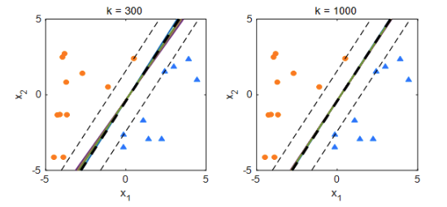

# Distributed SVM (Dual) via Blended Dynamics

A MATLAB simulation that solves the SVM dual problem in a distributed way using blended dynamics. Each agent holds a single data point and communicates only with its neighbors, through a coupling gain `k`.
The result is plotted against the centralized solution computed with CVX: the black dashed lines show the decision boundary and the margins.

This repository is the implementation of the following paper:

> Yerin Kim, Jeong Woo Kim, and Hyungbo Shim, "Design of Distributed Support Vector Machine Algorithm using Blended Dynamics Approach" (Blended dynamics를 이용한 서포트 벡터 머신의 분산 알고리즘 설계), *Proceedings of the 2021 IEIE Fall Conference*, pp. 528–530, Nov. 2021. [[DBpia]](https://www.dbpia.co.kr/journal/articleDetail?nodeId=NODE11027646)

## Files

| File | Description |
| --- | --- |
| `SVM_Dual_Simulation.m` | Main script. Generates the data, creates the agents and the adjacency matrix, integrates the blended dynamics of `w`, `b` and `z` (`alpha`), and plots the results. |
| `Agent.m` | Agent class. Holds each agent's state (`w`, `b`, `z`, `alpha`) and computes its time derivatives. |

## Requirements

- MATLAB R2017a or later (the script uses local functions and string `+` concatenation)
- Statistics and Machine Learning Toolbox (for `random`)
- [CVX](http://cvxr.com/cvx/) (used by `dual_opt_val` to compute the reference solution)

## Usage

In MATLAB, change to this folder and run:

```matlab
SVM_Dual_Simulation
```

- 20 random 2-D data points are generated. The agents are connected by a random graph in which each node links to 2 others.
- The simulation runs first with `k = 1000`, then continues with `k = 300`, and plots the two results side by side.
- With `dt = 1e-4` and `time = 20`, each run integrates 200,000 steps, so the simulation takes a while. Progress is printed when `verbose = 1`.
- Set `trajectory = 1` to also plot the time trajectories of `z` and `alpha`.
- To make the results reproducible, set a seed at the top of the script, e.g. `rng(1);`.

## Results



The proposed algorithm applied to a 2-dimensional dataset with `N = 20` agents (left: `k = 300`, right: `k = 1000`).

- **Solid lines**: the hyperplanes estimated by the `N` agents
- **Bold dashed line**: the global optimal hyperplane computed with CVX
- **Thin dashed lines**: the margins of the global optimal hyperplane

As the coupling gain `k` grows, the `N` agents' hyperplanes reach consensus and approximately converge to the global optimal hyperplane.

## Citation

```bibtex
@inproceedings{kim2021distributed,
  title     = {Design of Distributed Support Vector Machine Algorithm using Blended Dynamics Approach},
  author    = {Kim, Yerin and Kim, Jeong Woo and Shim, Hyungbo},
  booktitle = {Proceedings of the 2021 IEIE Fall Conference},
  pages     = {528--530},
  year      = {2021},
  month     = {nov}
}
```
